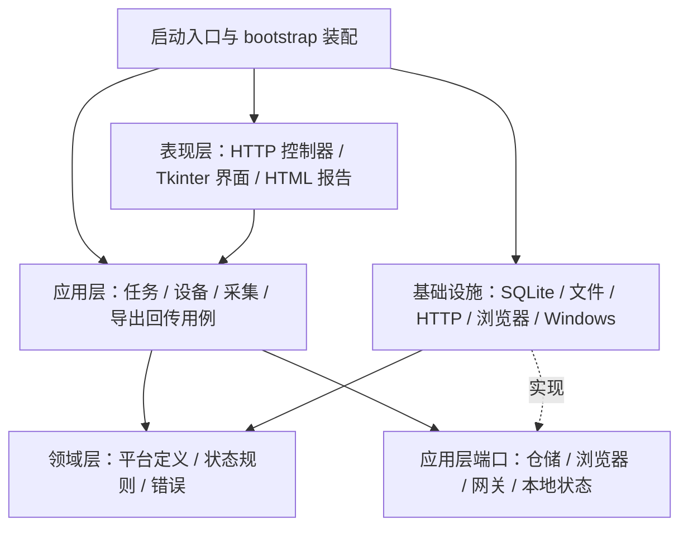

# 网页采集系统架构

当前结构版本：v0.12.0。目标流程是：提交问题，等待回答结束，导出完整正文和回答长图，通过页面分享按钮取得分享链接，持久保存并回传结果。

思考模式以 thinking_mode（None / True / False）贯穿表现层、领域验证、应用任务、子请求、检查点与结果。浏览器规则与切换校验放在 infrastructure/browser/thinking.py，由 Adapter 注入现有 BrowserActions/DesktopActions；应用用例只调用端口。界面选择不直接操作浏览器。发送前核验两次，最终动作通道在实际点击前执行 preflight；模式漂移则拒绝点击。恢复已发送会话只核对原 actual_options，不切换模式或重发。默认模式不产生点击，旧默认幂等请求保持兼容。

`browser/sessions.py` 管理专用浏览器的独立持有进程和 CDP 客户端租用。持有进程长期持有原平台 profile 锁，任务客户端另持 session-task 平台锁，定位只使用所属会话的主标签；客户端完成仅 browser.close 断开附着，不关闭所属 context。原 collection 用例和 report 回调仍在任务进程运行，发送前检查点顺序保持不变。默认 collect 使用常驻连接；resident=False 仅供隔离回归保留原生命周期。桌面平台页通过应用控制器和 runtime 获取会话状态，不直接读文件或操作 Playwright。

`browser/promotions.py` 处理已识别营销弹窗，优先检查人工验证；关闭控件仍走注入的 BrowserActions/DesktopActions。不能唯一确定关闭控件时报告 waiting_overlay 并等待用户，不下载、不自动重发；等待时间不计入回答超时。通过临时 DOM 标识固定本次已检查的弹窗与控件，避免列表变动后定位到另一个按钮。

桌面 `presentation/workbench.py` 负责页面导航，`theme.py` 统一字体与按钮，`batch_dialog.py` 同时支持嵌入工作区和独立窗口。应用 `platform_catalog.py` 合并受支持平台定义与待适配元数据并强制隔离执行权限。待适配信息由客户端 runtime 原子保存，不改变领域平台白名单。任务历史和结果文件访问由 runtime 提供，界面不直接读文件；复制分享链接仍不回退到原页面地址。扩展流程见 `PLATFORM_EXTENSION.md`。

智能体入口：`presentation/agent_http.py` 和 `agent_mcp.py` 负责协议，`application/agent.py` 校验并调用队列端口，`infrastructure/agent_queue.py` 持久化和串行派发既有本机批次，`agent_gateway.py` 连接本机 HTTP；`agent_bootstrap.py` 装配。MCP 不直接控制桌面。具体接入与恢复规则见 `AGENT_INTEGRATION.md`。

## 分层与依赖



领域层不能导入其他层。应用层通过端口使用外部能力，不能导入基础设施、界面、FastAPI、SQLite 或 Playwright。表现层调用应用服务，不能直接访问数据库或操作采集浏览器。具体依赖由 `*_bootstrap.py` 组装。基础设施可以依赖应用端口与数据契约，不能反向依赖表现层。

## 目录与职责

| 层 | 目录 / 模块 | 职责 |
| --- | --- | --- |
| 启动与装配 | `collector/bootstrap.py`、`client_bootstrap.py`、`collection_bootstrap.py`、`worker_bootstrap.py`、`local_bootstrap.py` | 创建配置、仓储、适配器和服务，连接输入输出端口 |
| 表现层 | `collector/presentation/http/` | 参数绑定、身份头解析、服务调用、状态码、下载响应和 URL 生成 |
| 桌面表现层 | `collector/presentation/desktop.py`、`report.py` | 控件、显示、用户事件、HTML 转义和报告排版 |
| 应用控制器 | `collector/application/desktop.py` | 配置导入与保存、启动和停止、界面动作编排 |
| 任务应用服务 | `collector/application/local_tasks.py` | 创建任务、幂等、租约、检查点、完成、失败、恢复和证据关联 |
| 设备应用服务 | `collector/application/devices.py`、`device_runner.py` | 设备凭据与会话、容量、领取重放、调度、心跳与排空 |
| 采集应用服务 | `collector/application/collection.py` | 新建或恢复会话，确认问题，等待结束，再调用证据导出能力 |
| 回传应用服务 | `collector/application/worker.py`、`local_test.py` | 本地检查点、证据续传、上传回执、本机测试流程 |
| 契约与端口 | `collector/application/contracts.py`、`ports.py`、`collection_ports.py`、`runtime_ports.py` | 输入验证、用例结果、外部依赖接口 |
| 领域层 | `collector/domain/` | 平台标识、错误、检查点不可回退、任务汇总状态与过期恢复策略 |
| 数据访问 | `collector/infrastructure/database.py`、`repositories.py`、`migrations.py` | SQLite 连接、事务、SQL、行数据转换与兼容迁移 |
| 本地存储 | `collector/infrastructure/artifacts.py`、`spool.py`、`local_test.py` | 原子写入、文件路径校验、SHA256、检查点、清单和回执 |
| 浏览器实现 | `collector/infrastructure/browser/` | 专用浏览器、配置目录锁、DOM 定位、发送和结束信号 |
| 证据实现 | `collector/infrastructure/evidence/` | 截图覆盖、真实像素拼接、来源提取、页面分享操作 |
| 外部连接与系统 | `collector/infrastructure/http_client.py`、`client_runtime.py`、`settings.py` | HTTP 请求、协议编码、Windows 启动项、子进程和环境配置 |

根目录的 `app.py`、`remote_server.py`、`desktop_client.py`、`real_worker.py` 等保留为兼容入口。它们不承载新业务逻辑；包内代码不能反过来导入这些入口。历史调试和验收脚本继续通过兼容入口运行。

## 关键约束

1. HTTP 控制器不写 SQL。SQL 仅出现在基础设施的仓储和迁移中，仓储返回普通字典、列表或标量，不向应用层泄露数据库游标。
2. 服务通过注入的工作单元执行事务。领取任务、轮换令牌、推进检查点仍保留既有事务边界。配置在应用创建时读取，导入应用服务不会创建数据库。
3. 问题发送前必须成功记录 `submission_uncertain`。检查点持久化失败时不得点击发送。已提交或可能提交的任务只恢复原会话，不自动换机器重新提问。
4. 确认回答结束后才导出。保存全文 TXT、原始 HTML、原始分段截图与经过覆盖检查的长图。存在缺口、遮挡或内部折叠时保留证据并明确提示。
5. `share_url` 只能来自分享后明确点击复制链接所得的本次剪贴板内容；`conversation_url` 保留为原会话恢复地址。不能用地址栏或旧剪贴板内容替代分享结果。
6. 已保存证据的上传重试只读取 spool，并校验文件哈希。上传失败不得重新调用采集器。附件只允许关联当前任务和执行次数。
7. 应用错误不携带 FastAPI 对象。HTTP 层负责将错误类别转换为状态码；传输实现将网络异常转换为应用可识别的错误。
8. 页面规则按平台配置。真实登录验收与模拟页面测试分别记录，重构不能把待验收的平台或分享流程标记为已验收。

## 扩展方式

- 新平台：补充领域平台定义与 `adapters.json`；特殊 DOM 操作放入浏览器实现，不能加到 HTTP 控制器或界面事件中。补充模拟页面和真实登录验收记录。
- 新输出格式：在证据实现中完成技术导出，由采集用例编排，结果契约和下载控制器只处理数据。不能通过修改网页正文来伪造截图。
- 新数据库或存储：实现工作单元/仓储或文件端口，在 bootstrap 替换实现；先验证租约、幂等与恢复语义。
- 新入口：复用应用服务，在表现层增加控制器，并由独立 bootstrap 装配。

## 开发检查

安装 `requirements-dev.txt` 后运行：

```powershell
.\.venv\Scripts\python.exe -m ruff check collector test_architecture.py build_release.py
.\.venv\Scripts\python.exe -m ruff format --check collector test_architecture.py build_release.py
.\.venv\Scripts\python.exe test_architecture.py
.\.venv\Scripts\python.exe test_local.py
.\.venv\Scripts\python.exe test_remote.py
.\.venv\Scripts\python.exe test_platforms.py
.\.venv\Scripts\python.exe test_browser.py
.\.venv\Scripts\python.exe test_exports.py
.\.venv\Scripts\python.exe test_upload_resume.py
.\.venv\Scripts\python.exe test_onboarding.py
.\.venv\Scripts\python.exe test_local_runner.py
```

`test_architecture.py` 检查依赖方向、应用服务无文件读写、领域规则、独立应用实例、发送前检查点以及未完成回答不得导出。集成测试继续检查真实 HTTP/SQLite 协议和模拟网页，不代表四个平台真实分享验收。

构建执行 `build_release.py`，实际 EXE 验证执行 `test_exe.py`。服务端包只包含服务器启动所需的分层模块和静态页面；不包含本机任务、登录状态、凭据和重构基线文件。

`test_release.py` 会验证发布文件哈希和源码一致性，并在临时目录独立解压服务端，隔离源码搜索路径后验证启动和四平台任务创建。数据库升级测试同时检查原任务保留及 WAL 已启用。

## 本机批量采集

`domain/batches.py` 负责问题分隔、数量限制和问题/平台展开。`application/local_batch.py` 负责串行调度、停止后续任务、平台级人工阻塞和状态汇总，通过端口保存进度，不直接操作文件或 Tkinter。`infrastructure/local_batch.py` 保存批次与独立子任务目录；`presentation/batch_dialog.py` 和 `batch_report.py` 负责多选界面与汇总报告；`local_bootstrap.run_batch` 统一组装。整个批次持有一次 worker-instance 锁，单项通过注入的空锁复用原单任务用例，避免重复加锁。

`test_batches.py` 覆盖笛卡尔展开、独立证据、不重复执行、停止、人工阻塞隔离、部分完成和 Tk 多选操作。批次 CLI 为 `desktop_client.py --local-batch request.json`。

人工验证接管由基础设施层 `browser/human_gate.py` 识别与等待，进度通过既有 report 回调通知应用与界面；不发送业务问题、不操作验证码。超时使用领域错误 HUMAN_VERIFICATION，沿用批次平台阻断规则。

## 桌面 RPA 试用层

领域 `interaction.py` 定义操作模式与试用平台范围；应用控制器和本机任务负责模式校验和逐项传递，不调用 Windows。界面提供独立 RPA 入口与模式选择。基础设施 `browser/interaction.py` 提供 BrowserActions 与 DesktopActions，Adapter 注入同一接口供提问和分享使用；WindowsDesktop 封装 HWND、坐标、焦点、桌面状态与 SendInput。读取、导航、截图与检查点保持原实现。服务端普通模式不引入原生 Windows/UI 依赖；默认 browser 字段不进入幂等序列化，以保持旧请求可重放。

RPA 通过正常 Windows 输入事件操作前台浏览器，平台验证码继续交给用户；不是浏览器指纹伪装实现。输入中断进入既有人工处理规则，不自动切回浏览器模式再次发送。

`browser/diagnostics.py` 在浏览器释放前记录异常并保留 RPA 失败现场，通过 browser_error 阶段和既有报告端口通知应用层。应用层仅传递错误状态，界面显示错误；保留期间不执行操作。运行时使用 no_viewport=True 保证 RPA DOM 坐标与本机视口一致。
