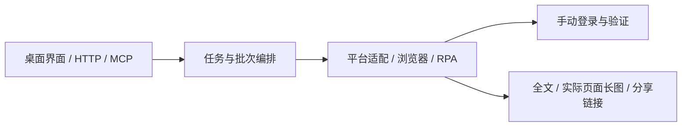

# 智叟云集 · AI 网页采集系统

**合肥域明科技出品｜智叟云集系统开源桌面采集端**

[官方平台](https://zhisouyunji.com/) · [架构说明](ARCHITECTURE.md) · [智能体接入](AGENT_INTEGRATION.md) · [扩展平台](PLATFORM_EXTENSION.md)

Windows 桌面应用，将多平台 AI 网页问答整理为可保存、可核对的回答全文、页面长图和会话分享链接。

## 功能

- 豆包、DeepSeek、腾讯元宝、千问的平台适配与独立常驻浏览器。
- 多平台 × 多问题批量任务，串行执行，逐项记录成功、部分完成和失败。
- 回答全文 TXT、真实页面分段截图和长图 PNG、页面分享按钮生成的链接。
- 独立思考模式选择：平台默认、开启、关闭；无法核验显式模式时停止该项。
- 登录与验证码人工接管，保留原浏览器和任务检查点，不自动重复提问。
- 本机 HTTP 与 MCP 接口，供智能体创建任务、查询进度、读取导出结果。

项目当前源码版本：**v0.14.1**。平台网页会变化，适配规则不代表所有账号、页面版本和模式均已完成实站验收。浏览器常驻不保证避免风控；程序不自动解决验证码。RPA 使用前台键鼠，执行期间请勿同时操作。

## 从源码运行

环境：Windows、Python 3.12、Microsoft Edge。请使用独立虚拟环境。

```powershell
python -m venv .venv
.\.venv\Scripts\python.exe -m pip install -r requirements-dev.txt
.\.venv\Scripts\python.exe desktop_client.py
```

首次使用在“平台登录与扩展”中打开需要的平台，手动登录后保留专用窗口；在批量采集页选择平台、填写问题并启动。输出默认保存在当前 Windows 用户的 `%LOCALAPPDATA%\WebCollector`。真实登录、问题和回答不会随本仓库提供。

下载本仓库源码 ZIP 后需按上述方式运行；本次首次公开上传不包含旧环境编译的 EXE。构建方法见下文。

## 结构

```text
collector/
  presentation/    桌面界面、HTTP/MCP 控制器与结果报告
  application/     任务编排、批次、检查点和设备用例
  domain/          平台、模式与业务规则
  infrastructure/  浏览器/RPA、文件、网络与存储
  *_bootstrap.py   依赖装配与运行入口
adapters.json      平台页面定位与模式规则
test_*.py          单元测试和本地网页测试
```



## 验证与构建

```powershell
.\.venv\Scripts\python.exe -m unittest test_architecture test_agent
.\.venv\Scripts\python.exe test_thinking.py
.\.venv\Scripts\python.exe -m pip install pyinstaller
.\.venv\Scripts\python.exe build_release.py
```

模拟网页测试不代表真实平台验收。涉及桌面输入的 `test_rpa.py --live` 仅在人工看护的独立本地测试环境运行。构建请使用干净环境，生成物放在 `releases/`，不提交到源码仓库。远程部署见 [REMOTE_DEPLOY.md](REMOTE_DEPLOY.md)，常驻窗口行为见 [RESIDENT_BROWSERS.md](RESIDENT_BROWSERS.md)。

## 参与与反馈

参见 [贡献指南](CONTRIBUTING.md) 和 [安全说明](SECURITY.md)。报告问题请提供版本、平台和脱敏错误码，不要公开 Cookie、密钥、客户问答、登录二维码或完整浏览器资料。

## 开源许可与品牌

源码采用 [Apache-2.0](LICENSE)，第三方组件遵循各自许可证，见 [THIRD_PARTY_NOTICES.md](THIRD_PARTY_NOTICES.md)。本项目是智叟云集系统的桌面采集端；线上平台的其他服务不因本仓库发布而自动纳入开源范围。

**合肥域明科技 · 智叟云集系统**  
官方平台：<https://zhisouyunji.com/>
